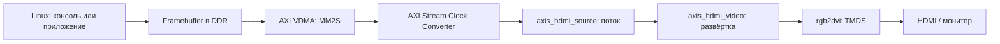

# Zynq-7020: Linux и HDMI

Учебный проект для **Vivado / SDK 2018.3**: вывод изображения из памяти ARM на HDMI через программируемую логику Zynq. На плате проверены загрузка с SD, тестовая картинка из DDR, сообщения Linux и приглашение `buildroot login:` на мониторе.

**Режим:** 1280×720, XRGB8888, около 59,93 Гц. **Основная ветка:** `main`.

[Подробное объяснение устройства и всей работы](HDMI_LINUX_RU.md) · [Автономный PL-тест](https://github.com/ZaharFilinskiy/zynq7020_linux_hdmi/tree/pl-hdmi-test) · [Работа с ветками](GIT_VERSIONS_RU.md)

## Два варианта проекта

| Ветка | Что делает | С чего начать |
|---|---|---|
| **[main](https://github.com/ZaharFilinskiy/zynq7020_linux_hdmi/tree/main)** | PS + DDR + AXI VDMA + HDMI. Linux пишет в framebuffer; на монитор выводится консоль | [Учебное описание](HDMI_LINUX_RU.md) |
| **[pl-hdmi-test](https://github.com/ZaharFilinskiy/zynq7020_linux_hdmi/tree/pl-hdmi-test)** | Аппаратный генератор полос, шахматного узора и белой рамки. В Block Design отсутствуют PS, DDR и VDMA | [Описание PL-варианта](https://github.com/ZaharFilinskiy/zynq7020_linux_hdmi/blob/pl-hdmi-test/HDMI_PL_ONLY_RU.md) |

В каждой ветке свой `zynq_linux.xpr`. Готовые файлы и команды сборки соответствуют выбранной ветке. Минимальный PL-вариант заново собран и проверен симуляцией; именно этот сокращённый bitstream после создания ветки на плату ещё не загружался.

## Как Linux попадает на экран



FSBL настраивает PS, загружает bitstream, рисует начальную картинку в DDR и запускает VDMA. Затем U-Boot загружает ядро и Device Tree с SD. Linux использует `simplefb` и `fbcon`, чтобы рисовать текст в том же буфере. Управление VDMA остаётся в firmware; параметры памяти согласованы с Device Tree.

Собственные Verilog-модули подключены как **Module Reference в Block Design**. Это даёт основу для следующего этапа — приёма кадров камеры, их буферизации и вывода через уже работающий тракт.

## Плата и инструменты

| Параметр | Использованная конфигурация |
|---|---|
| FPGA | Zynq-7020, `xc7z020clg400-2`, DDR 512 МиБ |
| Инструменты аппаратной части | Vivado 2018.3 и SDK 2018.3 |
| Опорный пример платы | `fpga_10_vga_hdmi_test`, подтверждённый на этой плате |
| Тактирование видео | Вход 50 МГц, PixelClk ≈ 74,166667 МГц, SerialClk ≈ 370,833333 МГц |
| Linux | `6.12.70-xilinx-hdmi`, существующая rootfs Buildroot |
| Framebuffer | `/dev/fb0`, 1280×720×32; база `0x18000000`, резерв 4 МиБ |
| Отладочная консоль | UART 115200, 8N1; на исходном ПК — COM3 |

Распиновка рассчитана на конкретную плату из опорного примера: генератор K17, reset_n M20, HDMI enable H18; TMDS clock H16/H17, D0 D19/D20, D1 C20/B20, D2 B19/A20. Перед переносом на другую плату сверьте [XDC](hdmi/constraints) со своей схемой.

## Открыть проект в Vivado

Клонируйте репозиторий и перейдите в его папку:

```powershell
git clone https://github.com/ZaharFilinskiy/zynq7020_linux_hdmi.git
Set-Location zynq7020_linux_hdmi
```

В свежей копии сначала восстановите generated products из сохранённого Block Design:

```powershell
& 'C:\Xilinx\Vivado\2018.3\bin\vivado.bat' -mode batch -source .\hdmi\tcl\prepare_from_git.tcl
```

Затем откройте **`zynq_linux.xpr`** в Vivado 2018.3. RTL, локальный IP `rgb2dvi` и ограничения уже находятся в репозитории. Путь к установленному Xilinx при необходимости замените своим.

Для отдельной папки PL-варианта, оставаясь в папке клона:

```powershell
git worktree add ..\zynq_pl_hdmi_test pl-hdmi-test
```

Далее выполняйте подготовку и открывайте `.xpr` уже из новой папки. Подробности — в [инструкции по веткам](GIT_VERSIONS_RU.md).

## Запустить Linux на HDMI

На исходной плате согласованный набор уже установлен на SD. Выберите загрузку с SD и включите питание; ожидаемый результат — начальная картинка, сообщения ядра и приглашение входа на HDMI. UART остаётся доступен.

Для повторной установки сохранены следующие файлы:

| Файл в репозитории | Путь на boot-разделе SD |
|---|---|
| [BOOT_HDMI_LINUX.BIN](hdmi/export/BOOT_HDMI_LINUX.BIN) | `BOOT.BIN` |
| [boot-hdmi.scr](hdmi/linux/build/boot-hdmi.scr) | `boot.scr` |
| [image-hdmi.ub](hdmi/linux/build/image-hdmi.ub) | `image-hdmi.ub` |
| [zynq-hdmi.dtb](hdmi/linux/zynq-hdmi.dtb) | `zynq-hdmi.dtb` |
| [start.sh](hdmi/linux/start.sh) | `linux-hdmi/start.sh` |
| [modules-hdmi.tar.gz](hdmi/linux/build/modules-hdmi.tar.gz) | `linux-hdmi/modules-hdmi.tar.gz` — затем распаковать |
| [fb_test](hdmi/linux/build/fb_test) | `linux-hdmi/fb_test` |

**Полный образ SD и rootfs Buildroot в репозитории отсутствуют.** Этот набор рассчитан на исходную рабочую SD этой платы. Для восстановления с нуля нужны совместимая rootfs, разметка SD, распаковка модулей и настройка `inittab` для монтирования модулей и входа на `tty1`. Порядок установки и отката подробно разобран в разделах 13, 18 и 19 [учебного описания](HDMI_LINUX_RU.md). Файлы BOOT, ядро и DTB следует использовать согласованным комплектом.

Простейшая проверка в работающем Linux:

```sh
cat /proc/fb
cat /sys/class/graphics/fb0/virtual_size
printf '\nHello from Linux to HDMI\n' > /dev/tty1
```

Ожидаются `0 simple`, размер `1280,720` и строка на мониторе. Для проверки цветов есть программа `/mnt/linux-hdmi/fb_test`; примеры её применения приведены в разделе 17 учебного описания.

## Пересобрать

После `prepare_from_git.tcl` аппаратная часть и FSBL собираются из папки проекта:

```powershell
& 'C:\Xilinx\Vivado\2018.3\bin\vivado.bat' -mode batch -source .\hdmi\tcl\build.tcl
& 'C:\Xilinx\SDK\2018.3\bin\xsct.bat' .\hdmi\tcl\build_sdk.tcl
Push-Location .\hdmi\export
& 'C:\Xilinx\SDK\2018.3\bin\bootgen.bat' -image boot-linux-hdmi.bif -arch zynq -o BOOT_HDMI_LINUX.BIN -w on
Pop-Location
```

Ядро, DTB и вспомогательные файлы собираются в Linux/WSL скриптами `hdmi/linux/build_linux.sh`, `prepare_dtb.sh` и `build_sd_tools.sh`. Исходники ядра привязаны к [конкретному коммиту Xilinx](https://github.com/Xilinx/linux-xlnx/commit/51bca7333c6f97b115a5db08a16f52597601fe49). Зависимости и последовательность сборки — в разделе 18 [HDMI_LINUX_RU.md](HDMI_LINUX_RU.md).

Кэши Vivado, generated IP, рабочая область SDK и временные результаты исключены из Git. Их восстанавливают скрипты; выбранные готовые загрузочные файлы и отчёты сохранены намеренно.

## Что проверено и что предстоит

- На плате подтверждены изображение из DDR и Linux с приглашением входа на HDMI; выполнены две повторные загрузки с SD.
- Проверены чтение/запись framebuffer и работа VDMA без ошибок. Для main: setup WNS **+4,525 нс**, hold WHS **+0,067 нс**.
- Для чистой Git-копии main проверены восстановление generated products и валидация BD. PL-вариант прошёл сборку, timing и симуляцию.
- Сохранены [итоговый протокол и SHA256](hdmi/export/linux_validation/final_result.json), [манифест установки на SD](hdmi/export/SD_DEPLOYMENT.json) и отчёты [timing](hdmi/export/timing.rpt) / [DRC](hdmi/export/drc.rpt).

Текущая версия использует один framebuffer: при обновлении возможен tearing. Режим экрана фиксирован; звук, EDID, DRM/KMS и приём камеры пока не реализованы. Холодный старт после установки финального набора отдельно не проверялся; подтверждены повторные программные загрузки с SD.

## Где разбираться в проекте

| Путь | Содержание |
|---|---|
| [HDMI_LINUX_RU.md](HDMI_LINUX_RU.md) | Подробное объяснение: архитектура, ход работы, выводы, сборка, диагностика, откат и следующий этап с камерой |
| [hdmi/rtl](hdmi/rtl) | Verilog источника потока и видеоразвёртки, комментарии к интерфейсу |
| [hdmi/hdmi_display.c](hdmi/hdmi_display.c) | Начальный framebuffer и настройка VDMA из FSBL |
| [hdmi/tcl](hdmi/tcl) | Подготовка, проверки, сборка Vivado и SDK |
| [hdmi/linux](hdmi/linux) | Device Tree, настройки ядра, сценарии загрузки и тест framebuffer |
| [hdmi/ip_repo](hdmi/ip_repo) | Локальный IP-передатчик Digilent rgb2dvi |
| [hdmi/export](hdmi/export) | Bitstream, HDF, FSBL, BOOT.BIN и отчёты |
| [zynq_linux.srcs](zynq_linux.srcs) | Block Design, wrapper и ограничения исходного проекта |

## Лицензия

В репозитории сохранена выбранная лицензия [GNU GPL v3](LICENSE). Сторонние компоненты сохраняют свои уведомления и условия: в частности, Digilent rgb2dvi содержит собственные лицензионные заголовки. Инструменты и стандартные IP Xilinx устанавливаются отдельно.
